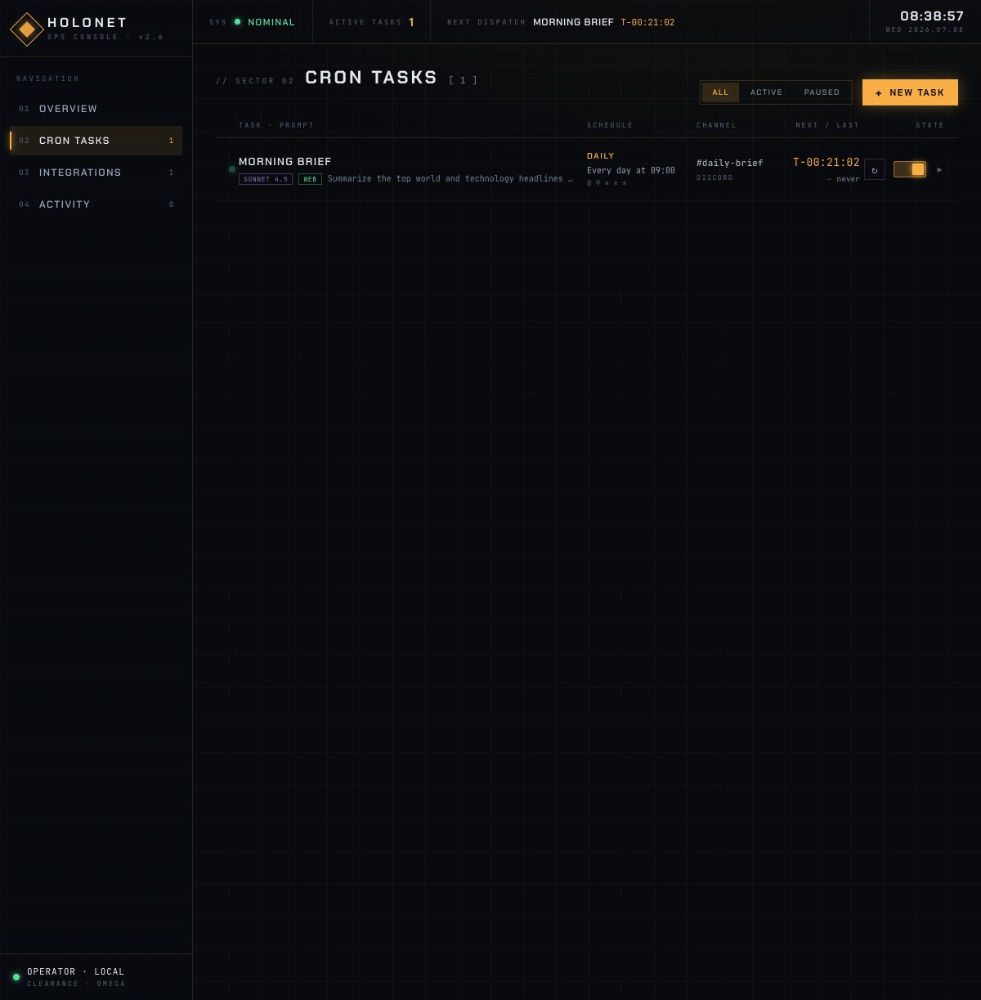

# Holonet

Holonet is a single-user personal ops console for **scheduled AI news dispatches**. You define
cron tasks; each task runs a prompt against an LLM via [OpenRouter](https://openrouter.ai)
(optionally with live web search), formats the answer (digest / bullets / headlines), and relays
it to a Discord webhook. A dashboard shows upcoming dispatches, task management, integrations and
an activity log.



The full visual reference lives at [`design/Holonet.dc.html`](design/Holonet.dc.html)
(sci-fi terminal aesthetic, amber-on-dark).

## Quick start (Docker)

```bash
cp .env.example .env
# edit .env — set at minimum APP_KEY (16+ chars) and OPENROUTER_API_KEY

docker compose up -d
```

The app is available at `http://localhost:3000`. Data (SQLite DB) persists in the
`holonet-data` Docker volume, mounted at `/data`.

## Local development

```bash
pnpm install
pnpm dev          # runs shared/web/server in watch mode, in parallel
```

Set the required env vars (see below) in your shell or a `.env` file read by your process
manager of choice — the server loads config via `apps/server/src/config.ts` (zod-parsed,
fails fast on missing/invalid values).

Other useful scripts (run from the repo root):

| Script | Does |
|---|---|
| `pnpm check` | Biome lint + format check |
| `pnpm typecheck` | `tsc --noEmit` across all workspaces |
| `pnpm test` | `node --test` across all workspaces |
| `pnpm build` | Builds `shared` → `web` → `server` in order |

## Architecture

- **Server:** [Hono](https://hono.dev) REST API under `/api`, serving the built React SPA
  statically. **DB:** SQLite via `better-sqlite3` + `drizzle-orm`, migrations applied
  programmatically at boot. **Scheduler:** `croner` for in-process cron scheduling.
  **Frontend:** React 19 + Vite + TanStack Query, ported pixel-for-pixel from
  `design/Holonet.dc.html`.
- **Auth:** single static `APP_KEY` compared with `crypto.timingSafeEqual`, exchanged for a
  signed, HttpOnly session cookie via Hono's built-in `setSignedCookie` — no `better-auth`
  dependency, since a single static credential doesn't need a full auth framework.

See [`docs/SPEC.md`](docs/SPEC.md) for the full architecture spec (API contract, DB schema,
scheduler/executor pipeline, frontend view breakdown).

## Environment variables

All variables are parsed by `apps/server/src/config.ts` (zod, fail-fast on invalid config).
`.env.example` documents all of these.

| Var | Required | Default | Purpose |
|---|---|---|---|
| `APP_KEY` | yes | — | The single auth credential. Min 16 chars enforced. |
| `OPENROUTER_API_KEY` | yes | — | OpenRouter bearer token. |
| `SESSION_SECRET` | no | sha256(APP_KEY + ":holonet-session") hex | HMAC key for signed cookie. |
| `DATABASE_PATH` | no | `./data/holonet.db` | SQLite file (dir auto-created). |
| `PORT` | no | `3000` | HTTP port. |
| `COOKIE_SECURE` | no | `false` | Set `true` behind TLS. |
| `TRUST_PROXY` | no | `false` | Trust X-Forwarded-For for client IP (set true only behind a reverse proxy). |
| `TZ` | no | system | Cron schedules interpret in this zone (croner default). |

The Docker image additionally sets `STATIC_DIR=/app/public` (path to the built SPA) — this is
not meant to be overridden unless you change the image layout.

## Deployment

> **Security:** the session cookie is sent over plain HTTP unless `COOKIE_SECURE=true`. Run
> behind TLS (a reverse proxy) for any non-LAN deployment and set `COOKIE_SECURE=true` (plus
> `TRUST_PROXY=true` when behind that proxy).

Images are published to GHCR on every push to `main` (tag `latest`) and on `v*` tags (semver
tags), via [`.github/workflows/docker.yml`](.github/workflows/docker.yml):

```
ghcr.io/wfalowski/holonet:latest
ghcr.io/wfalowski/holonet:sha-<short-sha>
ghcr.io/wfalowski/holonet:<semver>   # from a v* tag
```

To deploy or upgrade:

```bash
docker compose pull
docker compose up -d
```

CI (`.github/workflows/ci.yml`) runs `pnpm check`, `pnpm typecheck`, `pnpm test` and
`pnpm build` on every pull request and push to `main`.

## Data persistence

The SQLite database lives at `/data/holonet.db` inside the container, backed by the
`holonet-data` named volume. To back it up, copy the file out while the container is stopped
(or use SQLite's online backup while it's running):

```bash
docker compose stop holonet
docker run --rm -v holonet_holonet-data:/data -v "$PWD":/backup alpine \
  cp /data/holonet.db /backup/holonet-backup.db
docker compose start holonet
```
